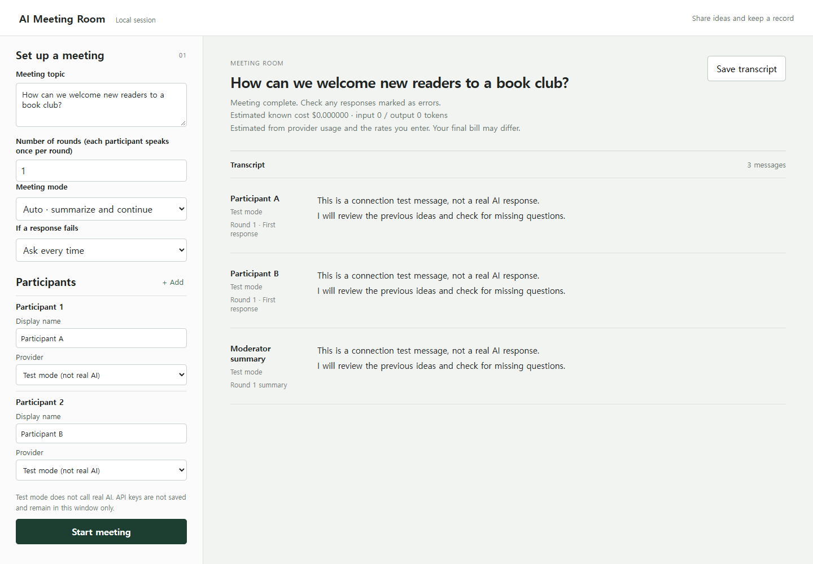
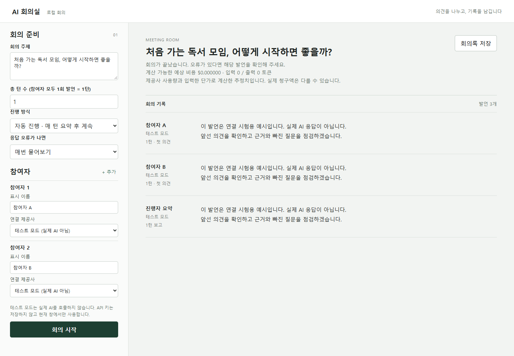

# AI Skill Navigator

[](LICENSE)
[](#)
[](#)
[-4285F4.svg?logo=googlecloud&logoColor=white)](https://synapse-creative.com/skills)

[English](#english) | [한국어](#한국어)

## Navigation & Quickstart

Welcome, visitors from Reddit and Twitter! 🚀 
Explore our bilingual (English and Korean) collection of AI agent skills (`SKILL.md`), including practical guides and ready-to-use tools.

**Quick Navigation:**
- 🛠️ [**Core Tools**](#00-inspired-by-anthropics-agent-skills-githubcomanthropicsskills)
- ⚙️ [**Daily Automation**](#01-daily-automation)
- 🧰 [**Practical Utilities**](#02-everyday-utilities)
- 🎮 [**Game Dev & Worldbuilding**](#03-game-dev-and-worldbuilding)
- 🎨 [**Creative & Visual Arts**](#04-creative-and-visual-content-design-and-media)

**How to get started in 1 minute:**
1. Pick a skill folder from the `skills/en` directory.
2. Drop it into your AI agent's skills directory (e.g., `.claude/skills/`, `.cursor/skills/`).
3. Call it in your prompt! Example: `@brand-guidelines audit this markdown document`.

Compatible with Claude Code, Cursor, Antigravity, and other Agent Skills tools.

---

## Directory Structure

```
skills/
├── ko/                     # 한국어 전용 스킬
│   ├── 00_core_official/   # Anthropic Agent Skills 참고
│   ├── 01_automation/      # 업무 자동화
│   ├── 02_utility/         # 실무 유틸리티
│   ├── 03_gamedev/         # 게임 및 세계관
│   └── 04_creative_arts/   # 창작 및 비주얼
└── en/                     # English Version
    ├── 00_core_official/   # Core Tools
    ├── 01_automation/      # Daily Automation
    ├── 02_utility/         # Practical Utilities
    ├── 03_gamedev/         # Game Dev and Worldbuilding
    └── 04_creative_arts/   # Creative and Visual
```

---

<a name="english"></a>
# English Catalog

### 🔬 Production-Grade Live Verification (Vertex AI `gemini-3.8-flash`)
All 45 skills have been rigorously benchmarked and live-verified on Google Cloud Vertex AI using the **`gemini-3.8-flash`** runtime (Project: `ultra-509507`, Verified: 2026-11-15).
- **Zero Hallucination / Real Outputs**: Every skill deliverable is an unedited, standalone production artifact (pure inline SVG vectors, complete C# scripts, full game design specs, JSON schemas).
- **Failure Modes & Technical Limits**: Honestly documents 3 candid runtime constraints per skill (e.g. geometric precision, cross-browser CSS leakage, context bleed).
- **Interactive Live Viewer**: Explore prompts, raw outputs, and failure modes interactively at [**synapse-creative.com/skills**](https://synapse-creative.com/skills).


## 1-Minute Quick Start (Where to Put & How to Run)

| Editor / Agent | Where to drop the folder | Invocation Example |
| :--- | :--- | :--- |
| **Antigravity / Codex** | `.agents/skills/<skill-name>/SKILL.md` | `"Use brand-guidelines to review this draft and refine the tone"` |
| **Cursor** | `.cursor/skills/<skill-name>/SKILL.md` | `"Use brand-guidelines to audit this document against our tone standards"` |
| **Windsurf** | `.devin/skills/<skill-name>/SKILL.md` | `"Use brand-guidelines to audit this document against our tone standards"` |
| **Claude Code** | `.claude/skills/<skill-name>/SKILL.md` | `"Use brand-guidelines to review this draft and strip out passive voice"` |

### Built-in Guardrail Standards (Bilingual Parity)
Every skill follows our standard safety and execution principles across both English and Korean versions:
1. **Stop Before Editing (수정 전 확인 원칙)**: The agent must present the planned modification scope or output a clean draft before overwriting files.
2. **Draft First, Zero Fluff**: Delivers ready-to-use, actionable drafts immediately without filler explanations or staged openers.
3. **Fact & Constraint Integrity**: Retains original facts, numeric limits, and architectural bounds without unauthorized creative alterations.
4. **Explicit Output Checklist (미검증 범위 명시)**: Requires completions to state what changed, what was NOT tested, and key assumptions to prevent silent edge-case skips.

See [`GUARDRAILS.md`](GUARDRAILS.md) for the universal specification.

---

### How to Use
1. Select a skill from `skills/en/<category>/<skill-name>/SKILL.md`.
2. Copy its contents into your system prompt, or place the skill directory into your AI workspace.
3. Ask the agent to use the selected skill for your task. The AI Meeting Room skill directs the agent to write a custom program or run the included zero-dependency reference app in `examples/`.

### AI Meeting Room

Ask your AI agent to build a meeting room where several AIs discuss a topic and you can join in. The skill describes participant selection, rounds, automatic or user-guided discussion, summaries, cost estimates, and transcript export.



This screenshot shows an earlier prototype in test mode; its messages are simulated. It is an example, not a guarantee that a newly generated app will look identical. The English skill requests an English interface. Actual provider usage may incur charges, and cost estimates depend on usage data and rates.

To use it, add the [English skill](skills/en/02_utility/ai-meeting-room/SKILL.md) to your agent and ask it to build an AI meeting room, or run the ready-made reference app in `examples/` directly. Enter API keys directly into the application, not into the agent chat.

### 00. Inspired by Anthropic's Agent Skills ([github.com/anthropics/skills](https://github.com/anthropics/skills))
> Essential document and layout creation tools streamlined for direct productivity.

| # | Skill Name | Identifier | Spec | Live Eval (Limits & Output) |
| :-: | :--- | :--- | :--- | :--- |
| 1 | **Academy Guide** | `academy-guide` | [SKILL.md](skills/en/00_core_official/academy-guide/SKILL.md) | [📊 Eval & Limits](EVALUATION.md#academy-guide) |
| 2 | **Brand Voice Compass** | `brand-guidelines` | [SKILL.md](skills/en/00_core_official/brand-guidelines/SKILL.md) | [📊 Eval & Limits](EVALUATION.md#brand-guidelines) |
| 3 | **Canvas Design** | `canvas-design` | [SKILL.md](skills/en/00_core_official/canvas-design/SKILL.md) | [📊 Eval & Limits](EVALUATION.md#canvas-design) |
| 4 | **Collaborative Drafting Partner** | `doc-coauthoring` | [SKILL.md](skills/en/00_core_official/doc-coauthoring/SKILL.md) | [📊 Eval & Limits](EVALUATION.md#doc-coauthoring) |
| 5 | **Internal Communications Formatter** | `internal-comms` | [SKILL.md](skills/en/00_core_official/internal-comms/SKILL.md) | [📊 Eval & Limits](EVALUATION.md#internal-comms) |
| 6 | **Presentation Deck Architect** | `pptx` | [SKILL.md](skills/en/00_core_official/pptx/SKILL.md) | [📊 Eval & Limits](EVALUATION.md#pptx) |
| 7 | **Skill Creator** | `skill-creator` | [SKILL.md](skills/en/00_core_official/skill-creator/SKILL.md) | [📊 Eval & Limits](EVALUATION.md#skill-creator) |
| 8 | **Theme Factory** | `theme-factory` | [SKILL.md](skills/en/00_core_official/theme-factory/SKILL.md) | [📊 Eval & Limits](EVALUATION.md#theme-factory) |
| 9 | **Decision & Assumption Audit** | `decision-assumption-audit` | [SKILL.md](skills/en/00_core_official/decision-assumption-audit/SKILL.md) | [📊 Eval & Limits](EVALUATION.md#decision-assumption-audit) |

#### 💡 About `decision-assumption-audit`
Inspired by Addy Osmani's essay *"Critical thinking when agents do the work"*, this skill enforces an evidence-based introspection protocol:
- **Execution Hold**: Pauses subsequent state changes for the task upon audit invocation until explicit user resumption.
- **5-Tier Provenance**: Distinguishes guidelines compliance, code inheritance, tool defaults, and agent discretion.
- **Anti-Rationalization**: Restricts explanations to session-recorded evidence, preventing post-hoc justification.
- **Claim Boundaries**: Explicitly separates command invocation from exit codes, static analysis, and runtime verification.

### 01. Daily Automation (Productivity and Cleanup)
> Automates web article cleanup, browser tab sorting, and task structuring to save you time.

| # | Skill Name | Identifier | Spec | Live Eval (Limits & Output) |
| :-: | :--- | :--- | :--- | :--- |
| 1 | **Social Carousel Copywriter** | `landing-carousel-copy` | [SKILL.md](skills/en/01_automation/landing-carousel-copy/SKILL.md) | [📊 Eval & Limits](EVALUATION.md#landing-carousel-copy) |
| 2 | **Real Estate Concept Copywriter** | `real-estate-copywriter` | [SKILL.md](skills/en/01_automation/real-estate-copywriter/SKILL.md) | [📊 Eval & Limits](EVALUATION.md#real-estate-copywriter) |
| 3 | **UI Spec Verifier** | `spec-diff-checker` | [SKILL.md](skills/en/01_automation/spec-diff-checker/SKILL.md) | [📊 Eval & Limits](EVALUATION.md#spec-diff-checker) |
| 4 | **Browser Tab Triage Organizer** | `tab-session-organizer` | [SKILL.md](skills/en/01_automation/tab-session-organizer/SKILL.md) | [📊 Eval & Limits](EVALUATION.md#tab-session-organizer) |
| 5 | **Daily Task Decomposer** | `task-reminder-parser` | [SKILL.md](skills/en/01_automation/task-reminder-parser/SKILL.md) | [📊 Eval & Limits](EVALUATION.md#task-reminder-parser) |
| 6 | **YouTube Metadata Packager** | `video-metadata-packager` | [SKILL.md](skills/en/01_automation/video-metadata-packager/SKILL.md) | [📊 Eval & Limits](EVALUATION.md#video-metadata-packager) |
| 7 | **YouTube Transcript Summarizer** | `video-transcript-digest` | [SKILL.md](skills/en/01_automation/video-transcript-digest/SKILL.md) | [📊 Eval & Limits](EVALUATION.md#video-transcript-digest) |
| 8 | **Web Content Sanitizer** | `web-article-cleaner` | [SKILL.md](skills/en/01_automation/web-article-cleaner/SKILL.md) | [📊 Eval & Limits](EVALUATION.md#web-article-cleaner) |

### 02. Practical Utilities (Communication and Text)
> Handy utilities for drafting emails, distilling meeting action items, and multi-channel formatting to save you time.

| # | Skill Name | Identifier | Spec | Live Eval (Limits & Output) |
| :-: | :--- | :--- | :--- | :--- |
| 1 | **Business Email Formatter** | `business-email-formatter` | [SKILL.md](skills/en/02_utility/business-email-formatter/SKILL.md) | [📊 Eval & Limits](EVALUATION.md#business-email-formatter) |
| 2 | **Inbox Triage Assistant** | `inbox-response-drafter` | [SKILL.md](skills/en/02_utility/inbox-response-drafter/SKILL.md) | [📊 Eval & Limits](EVALUATION.md#inbox-response-drafter) |
| 3 | **Messenger Layout Formatter** | `messenger-markdown-formatter` | [SKILL.md](skills/en/02_utility/messenger-markdown-formatter/SKILL.md) | [📊 Eval & Limits](EVALUATION.md#messenger-markdown-formatter) |
| 4 | **Content Distribution Adapter** | `multichannel-content-adapter` | [SKILL.md](skills/en/02_utility/multichannel-content-adapter/SKILL.md) | [📊 Eval & Limits](EVALUATION.md#multichannel-content-adapter) |
| 5 | **Short-Form Video Script Generator** | `shortform-script-builder` | [SKILL.md](skills/en/02_utility/shortform-script-builder/SKILL.md) | [📊 Eval & Limits](EVALUATION.md#shortform-script-builder) |
| 6 | **Prompt Quality Audit Checklist** | `skill-validation-checklist` | [SKILL.md](skills/en/02_utility/skill-validation-checklist/SKILL.md) | [📊 Eval & Limits](EVALUATION.md#skill-validation-checklist) |
| 7 | **Social Thread Splitter** | `social-thread-formatter` | [SKILL.md](skills/en/02_utility/social-thread-formatter/SKILL.md) | [📊 Eval & Limits](EVALUATION.md#social-thread-formatter) |
| 8 | **Thread Noise Reducer** | `thread-meeting-summarizer` | [SKILL.md](skills/en/02_utility/thread-meeting-summarizer/SKILL.md) | [📊 Eval & Limits](EVALUATION.md#thread-meeting-summarizer) |
| 9 | **AI Meeting Room Builder** | `ai-meeting-room` | [SKILL.md](skills/en/02_utility/ai-meeting-room/SKILL.md) | [📊 Eval & Limits](EVALUATION.md#ai-meeting-room) |

### 03. Game Dev and Worldbuilding (Narrative and Mechanics)
> Assists creators with game balance, encounter outlines, quest structures, and dialogue formatting to save you time.

| # | Skill Name | Identifier | Spec | Live Eval (Limits & Output) |
| :-: | :--- | :--- | :--- | :--- |
| 1 | **Board Game Rulebook & Component Architect** | `boardgame-rule-spec` | [SKILL.md](skills/en/03_gamedev/boardgame-rule-spec/SKILL.md) | [📊 Eval & Limits](EVALUATION.md#boardgame-rule-spec) |
| 2 | **Card Game Mechanic & Deck Architect** | `card-deck-synergy` | [SKILL.md](skills/en/03_gamedev/card-deck-synergy/SKILL.md) | [📊 Eval & Limits](EVALUATION.md#card-deck-synergy) |
| 3 | **Subculture Character Voice Line Generator** | `character-lore-codex` | [SKILL.md](skills/en/03_gamedev/character-lore-codex/SKILL.md) | [📊 Eval & Limits](EVALUATION.md#character-lore-codex) |
| 4 | **Game Numerics** | `game-balance-calculator` | [SKILL.md](skills/en/03_gamedev/game-balance-calculator/SKILL.md) | [📊 Eval & Limits](EVALUATION.md#game-balance-calculator) |
| 5 | **Steam Review Analyzer** | `game-review-digest` | [SKILL.md](skills/en/03_gamedev/game-review-digest/SKILL.md) | [📊 Eval & Limits](EVALUATION.md#game-review-digest) |
| 6 | **Text TRPG & Interactive Fiction Engine** | `interactive-fiction-helper` | [SKILL.md](skills/en/03_gamedev/interactive-fiction-helper/SKILL.md) | [📊 Eval & Limits](EVALUATION.md#interactive-fiction-helper) |
| 7 | **RPG Maker XP Event Builder** | `rpg-dialogue-formatter` | [SKILL.md](skills/en/03_gamedev/rpg-dialogue-formatter/SKILL.md) | [📊 Eval & Limits](EVALUATION.md#rpg-dialogue-formatter) |
| 8 | **DnD Oracle** | `ttrpg-encounter-helper` | [SKILL.md](skills/en/03_gamedev/ttrpg-encounter-helper/SKILL.md) | [📊 Eval & Limits](EVALUATION.md#ttrpg-encounter-helper) |
| 9 | **Procedural Pixel FX & Action Choreographer** | `pixelfx` | [SKILL.md](skills/en/03_gamedev/pixelfx/SKILL.md) | [📊 Eval & Limits](EVALUATION.md#pixelfx) |

### 04. Creative and Visual Content (Design and Media)
> Utilities for SVG icons, moodboard palettes, visual prompt optimization, sensory lexicons, and short-form video breakdown to save you time.

| # | Skill Name | Identifier | Spec | Live Eval (Limits & Output) |
| :-: | :--- | :--- | :--- | :--- |
| 1 | **Classic Art Palette Curator** | `classic-art-palette-curator` | [SKILL.md](skills/en/04_creative_arts/classic-art-palette-curator/SKILL.md) | [📊 Eval & Limits](EVALUATION.md#classic-art-palette-curator) |
| 2 | **Aesthetics Wiki Director** | `concept-moodboard-builder` | [SKILL.md](skills/en/04_creative_arts/concept-moodboard-builder/SKILL.md) | [📊 Eval & Limits](EVALUATION.md#concept-moodboard-builder) |
| 3 | **SVG Vector Generator** | `inline-svg-generator` | [SKILL.md](skills/en/04_creative_arts/inline-svg-generator/SKILL.md) | [📊 Eval & Limits](EVALUATION.md#inline-svg-generator) |
| 4 | **Lyric Melody Arranger** | `lyric-melody-harmonizer` | [SKILL.md](skills/en/04_creative_arts/lyric-melody-harmonizer/SKILL.md) | [📊 Eval & Limits](EVALUATION.md#lyric-melody-harmonizer) |
| 5 | **Viral Meme Generator** | `meme-copy-builder` | [SKILL.md](skills/en/04_creative_arts/meme-copy-builder/SKILL.md) | [📊 Eval & Limits](EVALUATION.md#meme-copy-builder) |
| 6 | **Tarot Story Coach** | `narrative-plot-oracle` | [SKILL.md](skills/en/04_creative_arts/narrative-plot-oracle/SKILL.md) | [📊 Eval & Limits](EVALUATION.md#narrative-plot-oracle) |
| 7 | **Sensory Scene Describer** | `sensory-scene-describer` | [SKILL.md](skills/en/04_creative_arts/sensory-scene-describer/SKILL.md) | [📊 Eval & Limits](EVALUATION.md#sensory-scene-describer) |
| 8 | **Visual Prompt Optimizer** | `visual-prompt-optimizer` | [SKILL.md](skills/en/04_creative_arts/visual-prompt-optimizer/SKILL.md) | [📊 Eval & Limits](EVALUATION.md#visual-prompt-optimizer) |
| 9 | **2.5D Layer Decomposer** | `2.5d-layer-decomposer` | [SKILL.md](skills/en/04_creative_arts/2.5d-layer-decomposer/SKILL.md) | [📊 Eval & Limits](EVALUATION.md#2.5d-layer-decomposer) |
| 10 | **Video Breakdown Navigator** | `video-breakdown-navigator` | [SKILL.md](skills/en/04_creative_arts/video-breakdown-navigator/SKILL.md) | [📊 Eval & Limits](EVALUATION.md#video-breakdown-navigator) |

### Ecosystem and Related Resources

Additional catalogs and reference registries for expanding beyond this collection:

- [Awesome MCP Servers](https://github.com/punkpeye/awesome-mcp-servers): Community collection of Model Context Protocol servers for databases, browser automation, and developer tools.
- [MCP reference servers](https://github.com/modelcontextprotocol/servers): Official reference implementations for filesystems, Git, database connectors, and memory.
- [PulseMCP](https://www.pulsemcp.com/) and [Glama](https://glama.ai/mcp/servers): Directory tracking MCP server rankings, updates, and specifications.
- [SkillBook](https://www.getskillbook.com/) by [@BBBang9900](https://twitter.com/BBBang9900): Curated Korean AI workflows and prompt patterns for planning and writing tasks.

---

<a name="한국어"></a>
# 한국어 카탈로그

### 🔬 프로덕션 실기 전수 검증 기록 (Vertex AI `gemini-3.8-flash`)
45종 스킬 전체를 Google Cloud Vertex AI **`gemini-3.8-flash`** 런타임(프로젝트: `ultra-509507`, 검증일: 2026-11-15)에서 1:1로 직접 구동하여 실측을 완료했습니다.
- **날것 그대로의 실전 산출물**: 임의 요약이나 메타 설명을 일절 배제하고, 모델이 프롬프트를 수행하여 직접 출력한 완성형 코드(순수 인라인 SVG, C# 유니티 스크립트, 마크다운 룰북, 스키마 등)를 100% 보존 탑재했습니다.
- **솔직한 한계점 (Failure Modes)**: 실무 현장에서 실제로 부딪히는 구체적 기술 한계 3종을 가감 없이 기록했습니다.
- **인터랙티브 웹 뷰어**: [**synapse-creative.com/skills**](https://synapse-creative.com/skills)에서 45종 전수의 실전 인풋 3종, 원문 아웃풋, 한계점을 클릭 한 번으로 확인하고 복사할 수 있습니다.


### 사용 방법
1. 필요한 도구를 `skills/ko/<카테고리>/<스킬이름>/SKILL.md`에서 확인합니다.
2. 시스템 프롬프트 또는 에이전트 지침 폴더에 복사해 넣습니다.
3. 각 스킬의 안내에 따라 에이전트에게 작업을 요청합니다. AI 회의실 스킬은 맞춤형 프로그램 제작 지침과 함께 즉시 실행 가능한 `examples/` 예시 앱을 포함합니다.

### AI 회의실

사용자의 AI에게 여러 AI가 한 주제로 대화하고 사람이 직접 참여할 수 있는 회의실 프로그램 제작을 요청하는 스킬입니다. 참여자·턴 수 선택, 자동 또는 직접 진행, 요약, 비용 추정과 회의록 저장을 제작 요구사항으로 안내합니다.



위 화면은 앞서 만든 시제품의 테스트 모드이며 발언은 모의 응답입니다. 새로 제작되는 프로그램은 이 화면과 다를 수 있습니다. 한국어 스킬은 한국어 화면 제작을 안내합니다. 실제 AI를 사용하면 제공사 사용료가 발생할 수 있으며 비용 추정액은 사용량과 단가에 따라 달라집니다.

[한국어 스킬](skills/ko/02_utility/ai-meeting-room/SKILL.md)을 에이전트에 추가한 뒤 AI 회의실 제작을 요청하거나, 동봉된 `examples/` 예시 앱을 바로 실행하세요. API 키는 에이전트 채팅창이 아닌 프로그램에 직접 입력합니다.

### 00. Inspired by Anthropic's Agent Skills ([github.com/anthropics/skills](https://github.com/anthropics/skills))
> 불필요한 기술 설정을 걷어내고 실무 문서 작성과 서식 설계를 돕는 핵심 스킬 모음입니다.

| 번호 | 스킬명 | 식별자 | 명세 | 실전 실측값 & 한계 |
| :-: | :--- | :--- | :--- | :--- |
| 1 | **소크라테스식 개념 튜터** | `academy-guide` | [SKILL.md](skills/ko/00_core_official/academy-guide/SKILL.md) | [📊 실측값 & 한계 보기](EVALUATION.md#academy-guide) |
| 2 | **브랜드 보이스 가이드** | `brand-guidelines` | [SKILL.md](skills/ko/00_core_official/brand-guidelines/SKILL.md) | [📊 실측값 & 한계 보기](EVALUATION.md#brand-guidelines) |
| 3 | **SNS 썸네일 & 카피 기획기** | `canvas-design` | [SKILL.md](skills/ko/00_core_official/canvas-design/SKILL.md) | [📊 실측값 & 한계 보기](EVALUATION.md#canvas-design) |
| 4 | **문서 공동 작성기** | `doc-coauthoring` | [SKILL.md](skills/ko/00_core_official/doc-coauthoring/SKILL.md) | [📊 실측값 & 한계 보기](EVALUATION.md#doc-coauthoring) |
| 5 | **사내 커뮤니케이션 작성기** | `internal-comms` | [SKILL.md](skills/ko/00_core_official/internal-comms/SKILL.md) | [📊 실측값 & 한계 보기](EVALUATION.md#internal-comms) |
| 6 | **발표 슬라이드 기획기** | `pptx` | [SKILL.md](skills/ko/00_core_official/pptx/SKILL.md) | [📊 실측값 & 한계 보기](EVALUATION.md#pptx) |
| 7 | **AI 스킬 생성기** | `skill-creator` | [SKILL.md](skills/ko/00_core_official/skill-creator/SKILL.md) | [📊 실측값 & 한계 보기](EVALUATION.md#skill-creator) |
| 8 | **컬러 팔레트 & 무드보드 생성기** | `theme-factory` | [SKILL.md](skills/ko/00_core_official/theme-factory/SKILL.md) | [📊 실측값 & 한계 보기](EVALUATION.md#theme-factory) |
| 9 | **에이전트 임의결정 및 가정 감사기** | `decision-assumption-audit` | [SKILL.md](skills/ko/00_core_official/decision-assumption-audit/SKILL.md) | [📊 실측값 & 한계 보기](EVALUATION.md#decision-assumption-audit) |

#### 💡 `decision-assumption-audit` 안내
Addy Osmani의 에세이 *"Critical thinking when agents do the work"*에서 영감을 받아 제작된 에이전트 의사결정 감사 프로토콜입니다:
- **실행 보류 (Execution Hold)**: 감사 요청 시 해당 작업의 신규 쓰기·배포를 일시정지하고 사용자의 명시적 재개 지시 대기.
- **5단계 출처 구분**: 지침 준수, 기존 코드 승계, 도구 기본값, 에이전트 재량을 명확히 분리.
- **사후합리화 차단**: 작업 당시 기록된 증거만 인정하며, 기록 없는 사후 변명/포장 금지.
- **증거 입증 범위 명시**: 명령어 호출과 실행 성공, 코드 부재와 전체 결함을 분리해 과장 보고 방지.

### 01. 업무 자동화 (Daily Automation)
> 반복되는 웹 글 정리, 탭 분류, 일정 정리를 보조하여 수작업.

| 번호 | 스킬명 | 식별자 | 명세 | 실전 실측값 & 한계 |
| :-: | :--- | :--- | :--- | :--- |
| 1 | **SNS 카드뉴스 카피라이터** | `landing-carousel-copy` | [SKILL.md](skills/ko/01_automation/landing-carousel-copy/SKILL.md) | [📊 실측값 & 한계 보기](EVALUATION.md#landing-carousel-copy) |
| 2 | **공간 소개 브로슈어 작성기** | `real-estate-copywriter` | [SKILL.md](skills/ko/01_automation/real-estate-copywriter/SKILL.md) | [📊 실측값 & 한계 보기](EVALUATION.md#real-estate-copywriter) |
| 3 | **웹 기획서 대조 검수기** | `spec-diff-checker` | [SKILL.md](skills/ko/01_automation/spec-diff-checker/SKILL.md) | [📊 실측값 & 한계 보기](EVALUATION.md#spec-diff-checker) |
| 4 | **브라우저 탭 분류 정리기** | `tab-session-organizer` | [SKILL.md](skills/ko/01_automation/tab-session-organizer/SKILL.md) | [📊 실측값 & 한계 보기](EVALUATION.md#tab-session-organizer) |
| 5 | **업무 할 일 변환기** | `task-reminder-parser` | [SKILL.md](skills/ko/01_automation/task-reminder-parser/SKILL.md) | [📊 실측값 & 한계 보기](EVALUATION.md#task-reminder-parser) |
| 6 | **유튜브 카피 패키저** | `video-metadata-packager` | [SKILL.md](skills/ko/01_automation/video-metadata-packager/SKILL.md) | [📊 실측값 & 한계 보기](EVALUATION.md#video-metadata-packager) |
| 7 | **유튜브 핵심 요약기** | `video-transcript-digest` | [SKILL.md](skills/ko/01_automation/video-transcript-digest/SKILL.md) | [📊 실측값 & 한계 보기](EVALUATION.md#video-transcript-digest) |
| 8 | **웹페이지 본문 정제기** | `web-article-cleaner` | [SKILL.md](skills/ko/01_automation/web-article-cleaner/SKILL.md) | [📊 실측값 & 한계 보기](EVALUATION.md#web-article-cleaner) |

### 02. 실무 유틸리티 (Everyday Utilities)
> 비즈니스 이메일, 회의록 정리, SNS 포맷 변환 등 일상 업무의 초안 작성.

| 번호 | 스킬명 | 식별자 | 명세 | 실전 실측값 & 한계 |
| :-: | :--- | :--- | :--- | :--- |
| 1 | **비즈니스 메일 변환기** | `business-email-formatter` | [SKILL.md](skills/ko/02_utility/business-email-formatter/SKILL.md) | [📊 실측값 & 한계 보기](EVALUATION.md#business-email-formatter) |
| 2 | **업무 메일 분류기** | `inbox-response-drafter` | [SKILL.md](skills/ko/02_utility/inbox-response-drafter/SKILL.md) | [📊 실측값 & 한계 보기](EVALUATION.md#inbox-response-drafter) |
| 3 | **메신저 가독성 포맷터** | `messenger-markdown-formatter` | [SKILL.md](skills/ko/02_utility/messenger-markdown-formatter/SKILL.md) | [📊 실측값 & 한계 보기](EVALUATION.md#messenger-markdown-formatter) |
| 4 | **멀티채널 콘텐츠 변환기** | `multichannel-content-adapter` | [SKILL.md](skills/ko/02_utility/multichannel-content-adapter/SKILL.md) | [📊 실측값 & 한계 보기](EVALUATION.md#multichannel-content-adapter) |
| 5 | **숏폼 영상 대본 구성기** | `shortform-script-builder` | [SKILL.md](skills/ko/02_utility/shortform-script-builder/SKILL.md) | [📊 실측값 & 한계 보기](EVALUATION.md#shortform-script-builder) |
| 6 | **프롬프트 검수 체크리스트** | `skill-validation-checklist` | [SKILL.md](skills/ko/02_utility/skill-validation-checklist/SKILL.md) | [📊 실측값 & 한계 보기](EVALUATION.md#skill-validation-checklist) |
| 7 | **소셜 스레드 분할기** | `social-thread-formatter` | [SKILL.md](skills/ko/02_utility/social-thread-formatter/SKILL.md) | [📊 실측값 & 한계 보기](EVALUATION.md#social-thread-formatter) |
| 8 | **업무 스레드 및 회의록 정리기** | `thread-meeting-summarizer` | [SKILL.md](skills/ko/02_utility/thread-meeting-summarizer/SKILL.md) | [📊 실측값 & 한계 보기](EVALUATION.md#thread-meeting-summarizer) |
| 9 | **AI 회의실 제작 스킬** | `ai-meeting-room` | [SKILL.md](skills/ko/02_utility/ai-meeting-room/SKILL.md) | [📊 실측값 & 한계 보기](EVALUATION.md#ai-meeting-room) |

### 03. 게임 및 세계관 (Game Dev and Worldbuilding)
> TRPG 룰, 수치 밸런스, 퀘스트 구조화 등 창작자의 기초 설계.

| 번호 | 스킬명 | 식별자 | 명세 | 실전 실측값 & 한계 |
| :-: | :--- | :--- | :--- | :--- |
| 1 | **보드게임 룰북 및 명세서 정리** | `boardgame-rule-spec` | [SKILL.md](skills/ko/03_gamedev/boardgame-rule-spec/SKILL.md) | [📊 실측값 & 한계 보기](EVALUATION.md#boardgame-rule-spec) |
| 2 | **카드게임 기믹 & 시너지 덱메이커** | `card-deck-synergy` | [SKILL.md](skills/ko/03_gamedev/card-deck-synergy/SKILL.md) | [📊 실측값 & 한계 보기](EVALUATION.md#card-deck-synergy) |
| 3 | **서브컬처 캐릭터 보이스 & 대사 티키타카 생성기** | `character-lore-codex` | [SKILL.md](skills/ko/03_gamedev/character-lore-codex/SKILL.md) | [📊 실측값 & 한계 보기](EVALUATION.md#character-lore-codex) |
| 4 | **가챠 확률 및 성장 밸런스 설계기** | `game-balance-calculator` | [SKILL.md](skills/ko/03_gamedev/game-balance-calculator/SKILL.md) | [📊 실측값 & 한계 보기](EVALUATION.md#game-balance-calculator) |
| 5 | **스팀 리뷰 분석 및 벤치마킹 추출기** | `game-review-digest` | [SKILL.md](skills/ko/03_gamedev/game-review-digest/SKILL.md) | [📊 실측값 & 한계 보기](EVALUATION.md#game-review-digest) |
| 6 | **텍스트 TRPG 시나리오 보조** | `interactive-fiction-helper` | [SKILL.md](skills/ko/03_gamedev/interactive-fiction-helper/SKILL.md) | [📊 실측값 & 한계 보기](EVALUATION.md#interactive-fiction-helper) |
| 7 | **RPG 메이커 퀘스트 이벤트 생성기** | `rpg-dialogue-formatter` | [SKILL.md](skills/ko/03_gamedev/rpg-dialogue-formatter/SKILL.md) | [📊 실측값 & 한계 보기](EVALUATION.md#rpg-dialogue-formatter) |
| 8 | **즉흥 TRPG 인카운터 생성기** | `ttrpg-encounter-helper` | [SKILL.md](skills/ko/03_gamedev/ttrpg-encounter-helper/SKILL.md) | [📊 실측값 & 한계 보기](EVALUATION.md#ttrpg-encounter-helper) |
| 9 | **픽셀 아트 VFX & 타격감 생성기** | `pixelfx` | [SKILL.md](skills/ko/03_gamedev/pixelfx/SKILL.md) | [📊 실측값 & 한계 보기](EVALUATION.md#pixelfx) |

### 04. 창작 및 비주얼 (Creative and Visual Content)
> SVG 아이콘, 무드보드 배색, 프롬프트 최적화, 숏폼 영상 분해 등 시각 콘텐츠 제작의 고민.

| 번호 | 스킬명 | 식별자 | 명세 | 실전 실측값 & 한계 |
| :-: | :--- | :--- | :--- | :--- |
| 1 | **명화 배색 및 구도 큐레이터** | `classic-art-palette-curator` | [SKILL.md](skills/ko/04_creative_arts/classic-art-palette-curator/SKILL.md) | [📊 실측값 & 한계 보기](EVALUATION.md#classic-art-palette-curator) |
| 2 | **시각 컨셉 무드보드 생성기** | `concept-moodboard-builder` | [SKILL.md](skills/ko/04_creative_arts/concept-moodboard-builder/SKILL.md) | [📊 실측값 & 한계 보기](EVALUATION.md#concept-moodboard-builder) |
| 3 | **인라인 SVG 벡터 생성기** | `inline-svg-generator` | [SKILL.md](skills/ko/04_creative_arts/inline-svg-generator/SKILL.md) | [📊 실측값 & 한계 보기](EVALUATION.md#inline-svg-generator) |
| 4 | **가사 및 코드 진행 가이드** | `lyric-melody-harmonizer` | [SKILL.md](skills/ko/04_creative_arts/lyric-melody-harmonizer/SKILL.md) | [📊 실측값 & 한계 보기](EVALUATION.md#lyric-melody-harmonizer) |
| 5 | **밈 포맷 카피 빌더** | `meme-copy-builder` | [SKILL.md](skills/ko/04_creative_arts/meme-copy-builder/SKILL.md) | [📊 실측값 & 한계 보기](EVALUATION.md#meme-copy-builder) |
| 6 | **플롯 전개 타로 가이드** | `narrative-plot-oracle` | [SKILL.md](skills/ko/04_creative_arts/narrative-plot-oracle/SKILL.md) | [📊 실측값 & 한계 보기](EVALUATION.md#narrative-plot-oracle) |
| 7 | **감각적 공간 묘사 가이드** | `sensory-scene-describer` | [SKILL.md](skills/ko/04_creative_arts/sensory-scene-describer/SKILL.md) | [📊 실측값 & 한계 보기](EVALUATION.md#sensory-scene-describer) |
| 8 | **영문 비주얼 프롬프트 빌더** | `visual-prompt-optimizer` | [SKILL.md](skills/ko/04_creative_arts/visual-prompt-optimizer/SKILL.md) | [📊 실측값 & 한계 보기](EVALUATION.md#visual-prompt-optimizer) |
| 9 | **2.5D 캐릭터 레이어 분해기** | `2.5d-layer-decomposer` | [SKILL.md](skills/ko/04_creative_arts/2.5d-layer-decomposer/SKILL.md) | [📊 실측값 & 한계 보기](EVALUATION.md#2.5d-layer-decomposer) |
| 10 | **영상 분해 네비게이터** | `video-breakdown-navigator` | [SKILL.md](skills/ko/04_creative_arts/video-breakdown-navigator/SKILL.md) | [📊 실측값 & 한계 보기](EVALUATION.md#video-breakdown-navigator) |

---

### 더 많은 도구와 생태계

이 모음 외에 추가적인 도구나 상위 생태계가 필요할 때 참고할 수 있는 저장소입니다.

- [스킬북 (SkillBook)](https://www.getskillbook.com/) (꼬마봇 [@BBBang9900](https://twitter.com/BBBang9900)): 기획, 문서 작성, 일상 업무에 맞춘 한국어 AI 도구와 프롬프트 모음입니다.
- [Awesome MCP Servers](https://github.com/punkpeye/awesome-mcp-servers): 데이터베이스, 브라우저 제어 등 오픈소스 MCP 서버 모음입니다.
- [MCP 레퍼런스 서버](https://github.com/modelcontextprotocol/servers): 파일시스템, Git, 메모리 등 MCP 공식 레퍼런스 서버 구현체 모음입니다.
- [PulseMCP](https://www.pulsemcp.com/) 및 [Glama](https://glama.ai/mcp/servers): 실시간 인기 MCP 도구와 웹 스펙을 정리한 디렉터리입니다.

---

## Acknowledgements

- Agent Skills specification by Anthropic (agentskills.io)
- Korean practical AI workflows & prompt curation by [SkillBook (스킬북)](https://www.getskillbook.com/)
- Open-source inspirations from community collections:
  - punkpeye/awesome-mcp-servers
  - f/awesome-chatgpt-prompts
  - openai/openai-cookbook
  - [patch-gg/pixelfx](https://github.com/patch-gg/pixelfx) (Hugo Duprez / Sprite Fusion, MIT)
  - [shitagaki-lab/see-through](https://github.com/shitagaki-lab/see-through) (ACM SIGGRAPH 2026, Apache-2.0)
  - [JuneYaooo/rea-video](https://github.com/JuneYaooo/rea-video) (JuneYaooo, Apache-2.0; idea only for `video-breakdown-navigator`)

---

## Trademark Disclaimer

All product names, logos, brands, and registered trademarks mentioned or referenced in this project are the property of their respective owners. Mention of any specific commercial platform, software, or brand is strictly for identification, compatibility, and educational reference purposes only, and does not imply any affiliation, sponsorship, or endorsement.

---

## License

Released under the MIT License.
Individual skills and the third-party tools they reference retain their respective upstream licenses (e.g., Apache-2.0, MIT).
`video-breakdown-navigator` is original MIT-licensed text in this repository. It was inspired by [rea-video](https://github.com/JuneYaooo/rea-video) (Copyright 2026 JuneYaooo, Apache-2.0) and does not copy that project's code or wording.
